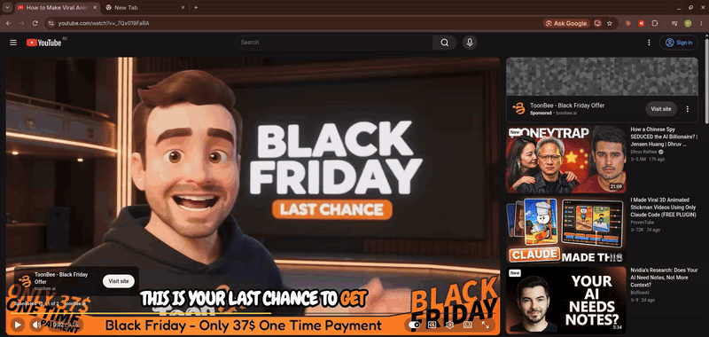

# Skip Ad for YouTube

**Skips the ad for you. Collects nothing.**

[](https://chromewebstore.google.com/detail/kdembckigpophgcgjfmbenkgnnkdoofe)



A Chrome extension that clicks YouTube's **Skip** button the moment an ad
becomes skippable. It is **not an ad blocker**: ads still start, and
unskippable ads play to the end. It just saves you from watching the corner
of the screen.

- 🔒 **No data collected.** No account, no analytics, no servers, no network
  requests. Settings stay on your computer.
- 🔑 **Two permissions:** storage, and youtube.com. Nothing else.
- 👀 **Open source, no build step:** the code in this repo is exactly what
  Chrome runs.

## Install

- **Chrome Web Store:** [install Skip Ad for YouTube](https://chromewebstore.google.com/detail/kdembckigpophgcgjfmbenkgnnkdoofe).
- **Manually, from a zip:** see the [User Guide](USER-GUIDE.md).

Then open any YouTube video. Click the toolbar icon to turn auto-skip off,
set a delay of 0–10 seconds, or see how many ads were skipped.

## Privacy

Full policy: **[PRIVACY.md](PRIVACY.md)**. In short:

- **Nothing leaves your computer.** The extension has no network code (the lint
  check fails if any is added), and the manifest's Content Security Policy
  (`connect-src 'none'`) makes Chrome itself block the popup from
  connecting anywhere.
- **What it stores:** your two settings (on/off, delay), the skip counter,
  and whether you answered the rating request, in Chrome's local extension
  storage. Not synced, not sent.
- **Why it needs youtube.com:** to see the ad's Skip button and click it.
  Chrome words this as "read and change your data on youtube.com"; it is the
  permission every extension needs to run on a site.
- **Check it yourself:** the [five-step check](PRIVACY.md#check-it-yourself)
  takes two minutes.
- **Pledge:** this extension will never be sold and will never add tracking.

## Troubleshooting

- **Ads aren't skipped any more.** Check that **Auto-skip ads** is ticked in
  the popup. If it is, YouTube has most likely changed its page:
  [report it](https://github.com/RabbiHasanR/yt-skip-ad/issues/new?template=stopped-working.yml),
  and the fix will come as an update.
- **Turn other ad extensions off** to test: an ad blocker hides the ad before
  there's a Skip button to click.

## Develop

Requires Node.js 24+ and, to build the zip, the `zip` command (Linux or
macOS). The extension itself has no build step; Chrome loads the files in
this repo directly. `npm` is only for tests, checks, and packaging.

```sh
npm ci
npx playwright install chromium   # once per machine, for end-to-end tests
npm test              # fast tests (unit + integration)
npm run test:e2e      # slow: real Chromium with the extension loaded, offline
npm run test:all      # both
npm run test:watch    # re-run on change
npm run lint          # ESLint
npm run typecheck     # tsc over JSDoc types
npm run format:check  # Prettier (npm run format to fix)
npm run coverage
npm run package       # dist/yt-skip-ad-<version>.zip, extension files only
npm run package:store # the same, for the Chrome Web Store (no manifest key)
```

After changing code, click the reload icon on the extension's card in
`chrome://extensions`, then reload the YouTube tab.

**Releasing:** bump `version` in `manifest.json` and run
`npm version <same version> --no-git-tag-version` (a test fails if they
differ). Then:

- `npm run package`: `dist/yt-skip-ad-<version>.zip` for manual installs
  (keeps the `key`, so the ID stays pinned).
- `npm run package:store`: `dist/yt-skip-ad-<version>-store.zip` to upload
  to the Chrome Web Store (same files, `key` removed; the store sets its
  own). Tag the release commit so anyone can compare the store build with
  the source.

Store listing text and privacy answers: [docs/store/listing.md](docs/store/listing.md).

**Extension ID:** the `key` in `manifest.json` fixes the ID to
`efdhjhghkcidlflkhipiaijdemjjknbl` wherever the folder lives. Its private
key is kept outside the repo and is only needed to build a `.crx`; never
commit a `.pem` file.

### Layout

| Path              | What                                                                              |
| ----------------- | --------------------------------------------------------------------------------- |
| `manifest.json`   | Extension manifest (MV3)                                                          |
| `src/core/`       | Rules: selectors, ad detection, skipper, settings, skip count, timing, rating ask |
| `src/shared/`     | Constants, settings defaults, and the storage adapter                             |
| `src/content/`    | `loader.js` imports `main.js`; `trusted-click.js`                                 |
| `src/background/` | Service worker: opens the popup at rating milestones                              |
| `popup/`          | Toolbar popup: auto-skip toggle, delay, skip counter, rating request              |
| `icons/`          | 16/48/128 px icons                                                                |
| `USER-GUIDE.md`   | Install, use, update, uninstall (also in the zip)                                 |
| `PRIVACY.md`      | Privacy policy, linked from the popup and the store listing                       |
| `docs/store/`     | Store listing text, privacy-practices answers, and images                         |
| `scripts/`        | Dev tooling: `package.js` builds the dist zip                                     |
| `tests/`          | `unit/`, `integration/`, `e2e/`, `fixtures/`, `setup/`                            |
| `specs/`          | Mission, roadmap, tech stack, and per-phase specs                                 |

**When skipping stops working**, YouTube has most likely renamed a class.
The selectors live in one place, `src/core/selectors.js`.

Work follows test-driven development; see
[specs/tech-stack.md](specs/tech-stack.md#development-workflow-tdd).
